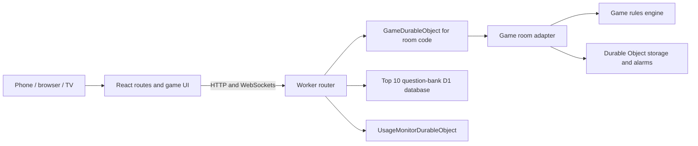

# Architecture

This is one React/TypeScript/Vite frontend on Cloudflare Pages and one Cloudflare Worker. Every lobby uses an instance of the existing `GameDurableObject` class, addressed by its four-digit room code. There is no separate backend service or database per game.

## Repository map

| Location | Responsibility |
| --- | --- |
| `shared/games.ts` | Stable game identifiers and type guards used by frontend and Worker |
| `shared/<game>.ts` | Public view/action models, rule settings, and reusable public calculations |
| `shared/*.mjs` and matching `.d.mts` files | Plain-Node content validation shared with build scripts |
| `backend-do/src/index.ts` | Public routing, creation/settings preflight, content catalogs, admin endpoints |
| `backend-do/src/game.ts` | Stable Durable Object export and serialized ownership/dispatch |
| `backend-do/src/registration.ts` | Exhaustive factories, settings preflight and legacy ownership precedence |
| `backend-do/src/platform/` | Composed execution, persistence and transport mechanics |
| `backend-do/src/top10/room.ts` | Legacy Top 10 implementation, isolated behind the same room interface |
| `backend-do/src/env.ts` | Worker binding types, independent of any game implementation |
| `backend-do/src/<game>/engine.ts` | Rules, state transitions, scoring, action validation, role-specific views |
| `backend-do/src/<game>/room.ts` | Authentication, transport, serialized persistence, broadcasts, alarms, usage tracking |
| `backend-do/src/auth.ts` | Admin and usage-override authentication |
| `backend-do/src/questionBanksDb.ts`, `migrations/` | Top 10 bank administration and revision history in D1 |
| `backend-do/src/usageMonitor.ts` | Usage counters, estimates, warning thresholds, creation guard |
| `frontend/src/App.tsx` | Homepage, game home routes, invite/display routes, legacy and admin routes |
| `frontend/src/components/GameRoute.tsx` | Fetch `/info` and open the matching game UI |
| `frontend/src/lib/games.ts` | Pure homepage copy/order, checked against the shared `GameType` |
| `frontend/src/app/games.tsx` | Exhaustive home/room components, lazy imports and supported displays |
| `frontend/src/games/<id>/` | Focused forms, tables, hands, responses and presentation |
| `frontend/src/hooks/` | Connection, command sending, interface preference and draft synchronization |
| `frontend/src/lib/session.ts` | Per-room browser sessions with legacy-key compatibility |
| `frontend/src/lib/profileStorage.ts`, `*Profiles.ts` | Shared storage mechanics and game-owned validation |
| `frontend/src/theme.css`, `styles.css`, `party.css` | Platform tokens, legacy shared styles, and platform UI |
| `frontend/src/*game*.css`, game components | Game-specific presentation and controls |
| `scripts/` | Canonical content validation/generation and explicit live verification |
| `tests/*.test.ts`, `tests/e2e/` | Node engine/adapter tests and multi-device browser tests |
| `docs/` | Current contributor documentation and staged refactoring proposals |

Backend folders use `justOne`, `soundsFishy`, and `monopolyDeal`; public IDs use `just-one`, `sounds-fishy`, and `monopoly-deal`. Keep that distinction when wiring a new game.

## A lobby's lifecycle

1. A home component submits `createGame` to the Worker. Omitted `gameType` continues to mean Top 10 for old clients.
2. The Worker validates game/settings and the usage guard, generates a code, and asks the Durable Object for that code to create a room. Collisions are retried.
3. `GameDurableObject` routes to the correct room adapter. Existing room detection also protects the shared code namespace when a different game tries to create the same code. Top 10 uses its own adapter with the legacy storage key `state`.
4. The adapter authenticates a player token or dedicated display capability. It restores persisted state and supplies a viewer-specific snapshot.
5. `useGameConnection` receives WebSocket states, retries with backoff, falls back to polling, and refreshes on visibility/network changes. It isolates snapshots by room/token and ignores older versions.
6. Commands pass through the adapter to the engine. The adapter commits room state and the next alarm together, then broadcasts separately projected views. Unconfirmed writes invalidate its cache and reconnect sockets; HTTP errors distinguish retryable uncertainty from rejected moves. Top 10 prompt selection also persists before broadcasting. See [persistence and recovery](persistence.md) for the failure contract and local-runtime tests.
7. Durable Object alarms advance timers/automatic rounds and handle expiry. A connected TV or host browser is not the timer authority.

## Boundaries to preserve

- An engine owns rules and calculations. React owns presentation; the adapter owns I/O. Keep deck values, role secrets, and authoritative scores out of client decisions.
- A public `View` is an allowlist projection of internal state. The host does not automatically get another player's secrets. Display credentials are read-only capabilities, not player seats.
- Existing games use different replay checks: generation/round/phase and/or revision, plus request IDs. Connection-only snapshot versions are not always gameplay revisions. These differences are deliberate compatibility constraints when extracting common code.
- Different viewers can receive different snapshots at the same version. Never reuse a serialized player snapshot for a different identity.
- Room storage keys, tokens, session keys, URLs, action fields, timer remainders, and migration tags are compatibility surfaces. A file reorganization must not rename them implicitly.
- `shared/` is imported by the browser. Secret decks, answers, seeds, banks, and server-only imports belong in the backend.
- Rendering and animation do not commit moves or advance scores. Reduced-motion mode must leave the same legal controls available.

## Current extension points and remaining duplication

The codebase has eight games and a useful engine/adapter/UI separation for seven of them. Game IDs are shared. Exhaustive frontend and backend maps register home/room components, supported displays, settings preflight and adapter factories. The dispatcher serializes ownership resolution and creation, caches the selected adapter, and preserves historical storage-key precedence. This does **not** claim that adding one registry entry fully installs a game; follow the [integration guide](adding-a-game.md).

The closest repeated room adapters are UNO, Monopoly Deal, Flip 7, and Skyjo. Shared composed helpers cover JSON responses, per-identity broadcasts, bounded socket membership, presence-write recovery and atomic persistence. Token lookup, game deadlines, commands and usage tracking remain explicit. Their rules, recovery behavior, settings, and view projection differ. No universal room superclass or generic rules engine is introduced. Frozen rooms, rollback execution and local runtime recovery tests protect these boundaries.

Top 10 is isolated from dispatch without changing its state format or public protocol. The root and backend each retain a Wrangler config describing the same Worker with paths relative to different directories. The frontend remains a separate npm project with its own install/lockfile.

Top 10 and Just One have no dedicated TV display. Their `/g/:code/display` routes explain this and offer an explicit link to the regular room, without mounting a player interface or opening a player connection. The normal-room link omits any display-token fragment. The six games with dedicated displays retain their existing routes.

## Content and browser caching

Canonical banks/packs are validated by four `sync:*` scripts. Outputs go to `backend-do/src/generated/` and, where intended, public bank folders. Sounds Fishy answers remain server-only. Just One translations stay server-side even though its word-bank assets are public by design. Top 10 also has D1-backed admin content; generated static banks are its fallback/source set.

`scripts/lib/write-if-changed.mjs` compares encoded bytes before writing output, preserving unchanged mtimes. Repeated development/build hooks still validate content, but no longer rewrite identical banks and cause unnecessary watcher invalidations. Output formatting and distribution paths stay the same.

`frontend/public/service-worker.js` supplies the PWA shell. Navigation/JSON are network-first; gameplay APIs and development source modules bypass caching. Do not introduce shared caching of authenticated game states. The usage monitor's estimates describe this application's recorded activity, not a replacement for Cloudflare billing data.

## Frontend ownership

`components/*Game.tsx` remains the route entry and owns session/connection/action orchestration. Focused components in `games/monopoly-deal`, `games/wavelength`, `games/uno` and `games/just-one` own their existing form or presentation state and receive public views and action callbacks. Their JSX/function bodies were moved mechanically; card renderers and scoped CSS remain separately replaceable.

`useRoomCommand` complements the single connection hook. Games construct complete actions with their own generation/phase/revision fields; the sender snapshots that decision, rejects overlapping submissions, and retains it for an uncertain retry. An acknowledged write followed by a failed readback is not offered for replay. Wavelength keeps its coalesced dial movement and explicit authoritative readback. Legacy Top 10 commands still have no request IDs and are not automatically replayed.

`profileStorage` shares browser-local mechanics while game wrappers preserve their existing keys, limits and validation policies. `useInterfaceLanguage` shares the existing interface preference across Fishy/Wavelength and tabs; content selections and dictionaries remain independent. See [styling](styling.md) for palette and renderer boundaries.
